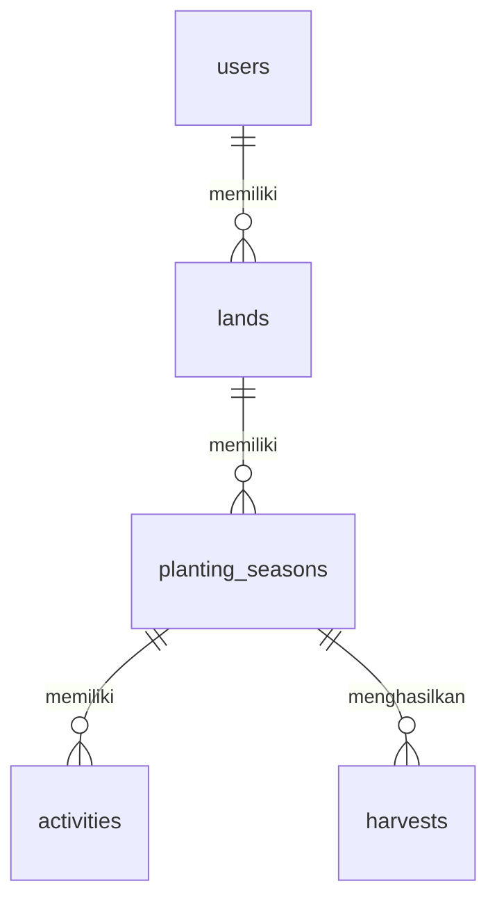

# Rancangan Database — Web Manajemen Lahan Pertanian

Dokumen ini menerjemahkan kebutuhan MVP pada [PRD.md](PRD.md) menjadi skema MySQL untuk aplikasi Laravel. Lima tabel inti adalah `users`, `lands`, `planting_seasons`, `activities`, dan `harvests`. Nama tabel menggunakan konvensi plural bahasa Inggris agar relasi Eloquent dapat digunakan tanpa pemetaan nama tabel khusus.

## 1. Konvensi Umum

- Semua tabel menggunakan mesin InnoDB dan karakter `utf8mb4`.
- Kolom `id` menggunakan `BIGINT UNSIGNED AUTO_INCREMENT` sebagai primary key. Semua foreign key yang merujuknya menggunakan `BIGINT UNSIGNED`.
- Setiap tabel memiliki `created_at` dan `updated_at` bertipe `TIMESTAMP NULL`, dikelola oleh Laravel.
- `NULL` hanya dipakai pada kolom yang memang opsional. Tipe `DECIMAL` dipakai untuk luas dan jumlah panen agar angka tidak berubah akibat pembulatan floating point.
- Nilai peran dan status disimpan sebagai string terbatas melalui `ENUM`, sesuai nilai yang ditetapkan di PRD. Perubahan daftar nilai pada masa depan memerlukan migration.
- Seluruh akses ke data pertanian dibatasi melalui relasi pemilik di sisi server. Foreign key menjaga integritas relasi, sedangkan policy atau query Laravel memeriksa hak akses.

## 2. Diagram Relasi

Satu petani dapat memiliki banyak lahan. Satu lahan dapat memiliki banyak musim tanam sepanjang waktu. Satu musim tanam dapat memiliki banyak kegiatan dan banyak catatan panen. Admin tetap disimpan di `users`, tetapi tidak mempunyai lahan dalam cakupan MVP.

## 3. Tabel Inti

Kolom `created_at` dan `updated_at` mengikuti konvensi pada bagian 1 dan berlaku untuk kelima tabel; keduanya tidak diulang pada setiap daftar kolom.

### 3.1 `users` — akun admin dan petani

| Kolom | Tipe MySQL | Null | Aturan / kegunaan |
| --- | --- | --- | --- |
| `id` | `BIGINT UNSIGNED` | Tidak | Primary key, auto increment. |
| `name` | `VARCHAR(150)` | Tidak | Nama pengguna. |
| `email` | `VARCHAR(255)` | Tidak | Email login; unique. |
| `password` | `VARCHAR(255)` | Tidak | Hash kata sandi, tidak pernah teks asli. |
| `role` | `ENUM('admin','petani')` | Tidak | Default `petani`; hanya seeder yang membuat `admin`. |
| `is_active` | `BOOLEAN` | Tidak | Default `TRUE`; `FALSE` menolak login. |

Indeks: `PRIMARY KEY (id)` dan `UNIQUE (email)`. Sebelum disimpan atau dipakai untuk login dan pengecekan keunikan, email dihapus spasinya lalu diubah menjadi huruf kecil. Normalisasi yang sama berlaku ketika admin membuat atau mengubah akun. Formulir registrasi dan panel admin tidak boleh menerima perubahan `role` dari input pengguna.

Akun petani tidak dihapus permanen dalam MVP; admin mengubah `is_active`. Dengan begitu, riwayat lahannya tetap tersimpan. Akun admin awal dibuat melalui seeder.

### 3.2 `lands` — lahan milik petani

| Kolom | Tipe MySQL | Null | Aturan / kegunaan |
| --- | --- | --- | --- |
| `id` | `BIGINT UNSIGNED` | Tidak | Primary key, auto increment. |
| `user_id` | `BIGINT UNSIGNED` | Tidak | Foreign key ke `users.id`; pemilik lahan. |
| `name` | `VARCHAR(150)` | Tidak | Nama lahan. |
| `area_hectares` | `DECIMAL(10,2)` | Tidak | Luas dalam hektare; harus lebih dari 0. |
| `location` | `VARCHAR(255)` | Tidak | Deskripsi lokasi dalam teks. |
| `notes` | `TEXT` | Ya | Catatan kondisi lahan. |

Relasi: `lands.user_id` → `users.id`, dengan `ON DELETE RESTRICT`. Indeks `lands(user_id)` mendukung daftar lahan per petani. Lahan hanya dapat dihapus jika tidak memiliki baris di `planting_seasons`.

### 3.3 `planting_seasons` — riwayat musim tanam

| Kolom | Tipe MySQL | Null | Aturan / kegunaan |
| --- | --- | --- | --- |
| `id` | `BIGINT UNSIGNED` | Tidak | Primary key, auto increment. |
| `land_id` | `BIGINT UNSIGNED` | Tidak | Foreign key ke `lands.id`. |
| `crop_name` | `VARCHAR(150)` | Tidak | Nama komoditas. |
| `planted_at` | `DATE` | Tidak | Tanggal mulai tanam. |
| `expected_harvest_at` | `DATE` | Tidak | Perkiraan tanggal panen; tidak sebelum `planted_at`. |
| `status` | `ENUM('aktif','selesai')` | Tidak | Default `aktif`. |
| `notes` | `TEXT` | Ya | Catatan musim tanam. |

Relasi: `planting_seasons.land_id` → `lands.id`, dengan `ON DELETE RESTRICT`. Indeks `planting_seasons(land_id, status)` mendukung daftar dan ringkasan musim aktif per lahan.

Musim `selesai` tetap disimpan sebagai riwayat dan dapat diaktifkan kembali. Kegiatan atau panen dalam musim tersebut tidak dapat ditambah atau diubah sebelum statusnya kembali `aktif`. Penghapusan musim tanam memerlukan konfirmasi aplikasi dan secara otomatis menghapus kegiatan serta panen yang terkait melalui aturan foreign key di bawah.

### 3.4 `activities` — kegiatan pertanian

| Kolom | Tipe MySQL | Null | Aturan / kegunaan |
| --- | --- | --- | --- |
| `id` | `BIGINT UNSIGNED` | Tidak | Primary key, auto increment. |
| `planting_season_id` | `BIGINT UNSIGNED` | Tidak | Foreign key ke `planting_seasons.id`. |
| `name` | `VARCHAR(150)` | Tidak | Nama atau jenis kegiatan. |
| `scheduled_for` | `DATE` | Tidak | Tanggal kegiatan. |
| `status` | `ENUM('direncanakan','selesai')` | Tidak | Default `direncanakan`. |
| `notes` | `TEXT` | Ya | Keterangan kegiatan. |

Relasi: `activities.planting_season_id` → `planting_seasons.id`, dengan `ON DELETE CASCADE`. Indeks `activities(planting_season_id, status, scheduled_for)` mendukung daftar kegiatan dan ringkasan yang belum selesai.

### 3.5 `harvests` — hasil panen

| Kolom | Tipe MySQL | Null | Aturan / kegunaan |
| --- | --- | --- | --- |
| `id` | `BIGINT UNSIGNED` | Tidak | Primary key, auto increment. |
| `planting_season_id` | `BIGINT UNSIGNED` | Tidak | Foreign key ke `planting_seasons.id`. |
| `harvested_at` | `DATE` | Tidak | Tanggal panen; tidak sebelum tanggal mulai tanam. |
| `quantity` | `DECIMAL(12,2)` | Tidak | Jumlah hasil; harus lebih dari 0. |
| `unit` | `ENUM('kg','ton')` | Tidak | Satuan hasil panen. |
| `notes` | `TEXT` | Ya | Catatan panen. |

Relasi: `harvests.planting_season_id` → `planting_seasons.id`, dengan `ON DELETE CASCADE`. Indeks `harvests(planting_season_id, unit)` mendukung ringkasan panen per musim dan satuan. Total panen dihitung dengan `SUM(quantity)` per pasangan `planting_season_id` dan `unit`; kilogram dan ton tidak dijumlahkan langsung. Satu musim dapat memiliki beberapa catatan panen.

## 4. Aturan Relasi dan Penghapusan

| Relasi | Kardinalitas | Saat induk dihapus |
| --- | --- | --- |
| `users` → `lands` | Satu ke banyak | `RESTRICT`; akun petani dinonaktifkan, bukan dihapus. |
| `lands` → `planting_seasons` | Satu ke banyak | `RESTRICT`; hapus seluruh musim tanam terlebih dahulu. |
| `planting_seasons` → `activities` | Satu ke banyak | `CASCADE`; kegiatan terkait ikut terhapus. |
| `planting_seasons` → `harvests` | Satu ke banyak | `CASCADE`; panen terkait ikut terhapus. |

Saat menghapus lahan atau musim tanam, aplikasi harus memastikan bahwa pengguna yang sedang login adalah pemilik lahan tersebut. Konfirmasi penghapusan musim tanam ditampilkan sebelum operasi dijalankan. Foreign key mengamankan konsistensi data, tetapi tidak menggantikan pemeriksaan pemilik pada aplikasi.

## 5. Validasi dan Kebutuhan Operasional

- `email` wajib unik setelah normalisasi. Simpan hasil normalisasi agar indeks unique di database menjadi pengaman terakhir terhadap duplikasi.
- Kata sandi registrasi dan akun yang dibuat admin minimal 8 karakter sebelum di-hash. Kolom `password` menyimpan hasil hash Laravel.
- `area_hectares` dan `quantity` harus positif. `expected_harvest_at` tidak boleh lebih awal dari `planted_at`; `harvested_at` tidak boleh lebih awal dari `planted_at`.
- `role` tidak dapat diedit lewat panel admin. Registrasi publik selalu menghasilkan `role = petani` dan `is_active = TRUE`.
- Akun dengan `is_active = FALSE` ditolak saat login. Apabila admin menonaktifkan akun yang sedang memiliki sesi, middleware juga harus menolak akses berikutnya.
- Pembatasan login 5 percobaan per menit dan registrasi 3 percobaan per jam per IP dikelola oleh rate limiter Laravel. Ini adalah data sementara aplikasi, bukan tabel domain baru.
- Flash session untuk mengisi email pada halaman login setelah registrasi merupakan data sesi sementara, bukan kolom `users`.
- Migration standar Laravel dapat membuat tabel infrastruktur tambahan sesuai driver sesi, cache, dan queue yang dipilih. Tabel tersebut terpisah dari lima tabel domain MVP dalam dokumen ini.

## 6. Contoh Alur Data

1. Registrasi membuat satu baris `users` dengan `role = petani` dan `is_active = TRUE`.
2. Petani menambah lahan; `lands.user_id` menunjuk ke akun tersebut.
3. Petani membuat musim tanam; `planting_seasons.land_id` menunjuk ke lahannya.
4. Kegiatan dan catatan panen menunjuk ke `planting_seasons.id`.
5. Dashboard mengambil lahan melalui `users.id`, lalu menampilkan musim aktif, kegiatan belum selesai, dan total panen yang dikelompokkan menurut satuan.
