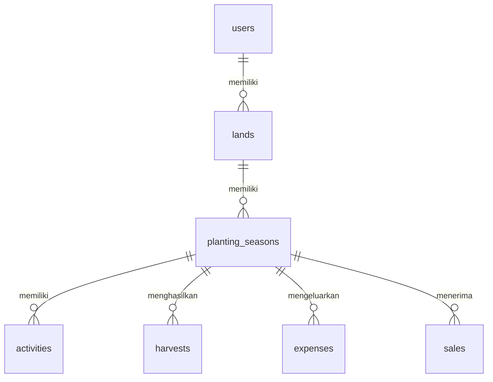

# Rancangan Database — Web Manajemen Lahan Pertanian

Dokumen ini menerjemahkan kebutuhan MVP pada [PRD.md](PRD.md) menjadi skema MySQL untuk aplikasi Laravel. Tujuh tabel inti adalah `users`, `lands`, `planting_seasons`, `activities`, `harvests`, `expenses`, dan `sales`. Nama tabel menggunakan konvensi plural bahasa Inggris agar relasi Eloquent dapat digunakan tanpa pemetaan nama tabel khusus.

## 1. Konvensi Umum

- Semua tabel menggunakan mesin InnoDB dan karakter `utf8mb4`.
- Kolom `id` menggunakan `BIGINT UNSIGNED AUTO_INCREMENT` sebagai primary key. Semua foreign key yang merujuknya menggunakan `BIGINT UNSIGNED`.
- Setiap tabel memiliki `created_at` dan `updated_at` bertipe `TIMESTAMP NULL`, dikelola oleh Laravel.
- `NULL` hanya dipakai pada kolom yang memang opsional. Tipe `DECIMAL` dipakai untuk luas dan jumlah panen agar angka tidak berubah akibat pembulatan floating point.
- Nilai peran dan status disimpan sebagai string terbatas melalui `ENUM`, sesuai nilai yang ditetapkan di PRD. Perubahan daftar nilai pada masa depan memerlukan migration.
- Seluruh akses ke data pertanian dibatasi melalui relasi pemilik di sisi server. Foreign key menjaga integritas relasi, sedangkan policy atau query Laravel memeriksa hak akses.

## 2. Diagram Relasi

Satu petani dapat memiliki banyak lahan. Satu lahan dapat memiliki banyak musim tanam sepanjang waktu. Satu musim tanam dapat memiliki banyak kegiatan dan banyak catatan panen. Admin tetap disimpan di `users`, tetapi tidak mempunyai lahan dalam cakupan MVP.

## 3. Tabel Inti

Kolom `created_at` dan `updated_at` mengikuti konvensi pada bagian 1 dan berlaku untuk ketujuh tabel; keduanya tidak diulang pada setiap daftar kolom.

### 3.1 `users` — akun admin dan petani

| Kolom | Tipe MySQL | Null | Aturan / kegunaan |
| --- | --- | --- | --- |
| `id` | `BIGINT UNSIGNED` | Tidak | Primary key, auto increment. |
| `name` | `VARCHAR(150)` | Tidak | Nama pengguna. |
| `email` | `VARCHAR(255)` | Tidak | Email login; unique. |
| `password` | `VARCHAR(255)` | Tidak | Hash kata sandi, tidak pernah teks asli. |
| `role` | `ENUM('admin','petani')` | Tidak | Default `petani`; hanya seeder yang membuat `admin`. |
| `is_active` | `BOOLEAN` | Tidak | Default `TRUE`; `FALSE` menolak login. |

Indeks: `PRIMARY KEY (id)` dan `UNIQUE (email)`. Sebelum disimpan atau dipakai untuk login dan pengecekan keunikan, email dihapus spasinya lalu diubah menjadi huruf kecil. Dalam MVP, akun petani dibuat melalui registrasi mandiri; panel admin tidak menerima perubahan nama, email, kata sandi, atau `role` dari input admin.

Akun petani tidak dihapus permanen dalam MVP; admin hanya dapat mengubah `is_active` setelah konfirmasi. Dengan begitu, riwayat lahannya tetap tersimpan. Akun admin awal dibuat melalui seeder.

### 3.2 `lands` — lahan milik petani

| Kolom | Tipe MySQL | Null | Aturan / kegunaan |
| --- | --- | --- | --- |
| `id` | `BIGINT UNSIGNED` | Tidak | Primary key, auto increment. |
| `user_id` | `BIGINT UNSIGNED` | Tidak | Foreign key ke `users.id`; pemilik lahan. |
| `name` | `VARCHAR(150)` | Tidak | Nama lahan. |
| `area_hectares` | `DECIMAL(10,2)` | Tidak | Luas dalam hektare; harus lebih dari 0. |
| `location` | `VARCHAR(255)` | Tidak | Deskripsi lokasi dalam teks. |
| `notes` | `TEXT` | Ya | Catatan kondisi lahan. |

Relasi: `lands.user_id` → `users.id`, dengan `ON DELETE RESTRICT`. Indeks `lands(user_id)` mendukung daftar lahan per petani. Lahan hanya dapat dihapus jika tidak memiliki baris di `planting_seasons`.

### 3.3 `planting_seasons` — riwayat musim tanam

| Kolom | Tipe MySQL | Null | Aturan / kegunaan |
| --- | --- | --- | --- |
| `id` | `BIGINT UNSIGNED` | Tidak | Primary key, auto increment. |
| `land_id` | `BIGINT UNSIGNED` | Tidak | Foreign key ke `lands.id`. |
| `crop_name` | `VARCHAR(150)` | Tidak | Nama komoditas. |
| `planted_at` | `DATE` | Tidak | Tanggal mulai tanam. |
| `expected_harvest_at` | `DATE` | Tidak | Perkiraan tanggal panen; tidak sebelum `planted_at`. |
| `status` | `ENUM('aktif','selesai')` | Tidak | Default `aktif`. |
| `notes` | `TEXT` | Ya | Catatan musim tanam. |

Relasi: `planting_seasons.land_id` → `lands.id`, dengan `ON DELETE RESTRICT`. Indeks `planting_seasons(land_id, status)` mendukung daftar dan ringkasan musim aktif per lahan.

Musim baru dibuat dengan status `aktif` oleh server; satu lahan boleh memiliki beberapa musim aktif. Musim `selesai` tetap disimpan sebagai riwayat dan dapat diaktifkan kembali setelah konfirmasi. Informasi musim selesai tidak dapat diedit, dan kegiatan/panen tidak dapat ditambah, diubah, atau dihapus sampai statusnya kembali `aktif`. Catatan keuangan tetap dapat diperbarui pada musim selesai. Penghapusan seluruh musim diperbolehkan setelah konfirmasi dan secara otomatis menghapus kegiatan, panen, pengeluaran, serta penjualan terkait melalui foreign key. Dialog menampilkan jumlah setiap jenis catatan. Perubahan tanggal tanam harus ditolak jika ada catatan panen sebelum tanggal tanam baru.

### 3.4 `activities` — kegiatan pertanian

| Kolom | Tipe MySQL | Null | Aturan / kegunaan |
| --- | --- | --- | --- |
| `id` | `BIGINT UNSIGNED` | Tidak | Primary key, auto increment. |
| `planting_season_id` | `BIGINT UNSIGNED` | Tidak | Foreign key ke `planting_seasons.id`. |
| `name` | `VARCHAR(150)` | Tidak | Nama atau jenis kegiatan. |
| `scheduled_for` | `DATE` | Tidak | Tanggal kegiatan. |
| `status` | `ENUM('direncanakan','selesai')` | Tidak | Default `direncanakan`. |
| `notes` | `TEXT` | Ya | Keterangan kegiatan. |

Relasi: `activities.planting_season_id` → `planting_seasons.id`, dengan `ON DELETE CASCADE`. Indeks `activities(planting_season_id, status, scheduled_for)` mendukung daftar kegiatan dan ringkasan yang belum selesai.

### 3.5 `harvests` — hasil panen

| Kolom | Tipe MySQL | Null | Aturan / kegunaan |
| --- | --- | --- | --- |
| `id` | `BIGINT UNSIGNED` | Tidak | Primary key, auto increment. |
| `planting_season_id` | `BIGINT UNSIGNED` | Tidak | Foreign key ke `planting_seasons.id`. |
| `harvested_at` | `DATE` | Tidak | Tanggal panen; tidak sebelum tanggal mulai tanam. |
| `quantity` | `DECIMAL(12,2)` | Tidak | Jumlah hasil; harus lebih dari 0. |
| `unit` | `ENUM('kg','ton')` | Tidak | Satuan hasil panen. |
| `notes` | `TEXT` | Ya | Catatan panen. |

Relasi: `harvests.planting_season_id` → `planting_seasons.id`, dengan `ON DELETE CASCADE`. Indeks `harvests(planting_season_id, unit)` mendukung ringkasan panen per musim dan satuan. Total panen dihitung dengan `SUM(quantity)` per pasangan `planting_season_id` dan `unit`; kilogram dan ton tidak dijumlahkan langsung. Satu musim dapat memiliki beberapa catatan panen.

### 3.6 `expenses` — pengeluaran per musim

| Kolom | Tipe MySQL | Null | Aturan / kegunaan |
| --- | --- | --- | --- |
| `id` | `BIGINT UNSIGNED` | Tidak | Primary key, auto increment. |
| `planting_season_id` | `BIGINT UNSIGNED` | Tidak | Foreign key ke `planting_seasons.id`. |
| `spent_on` | `DATE` | Tidak | Tanggal pembayaran; boleh sebelum tanggal tanam. |
| `name` | `VARCHAR(150)` | Tidak | Nama pengeluaran. |
| `category` | `ENUM('bibit','pupuk','pestisida','upah','irigasi','sewa','transportasi','lainnya')` | Tidak | Kategori pengeluaran. |
| `amount` | `DECIMAL(15,2)` | Tidak | Nominal rupiah yang sudah dibayar, lebih dari nol. |
| `notes` | `TEXT` | Ya | Catatan, maksimal 5.000 karakter pada aplikasi. |

Foreign key memakai `ON DELETE CASCADE`. Indeks `expenses(planting_season_id, spent_on)` mendukung daftar pengeluaran per musim. Nominal maksimum 9.999.999.999.999,99 dan maksimal dua angka desimal.

### 3.7 `sales` — penerimaan penjualan per musim

| Kolom | Tipe MySQL | Null | Aturan / kegunaan |
| --- | --- | --- | --- |
| `id` | `BIGINT UNSIGNED` | Tidak | Primary key, auto increment. |
| `planting_season_id` | `BIGINT UNSIGNED` | Tidak | Foreign key ke `planting_seasons.id`. |
| `received_on` | `DATE` | Tidak | Tanggal uang diterima; boleh sebelum tanggal tanam. |
| `name` | `VARCHAR(150)` | Tidak | Keterangan penjualan. |
| `amount` | `DECIMAL(15,2)` | Tidak | Nominal rupiah yang sudah diterima, lebih dari nol. |
| `notes` | `TEXT` | Ya | Catatan, maksimal 5.000 karakter pada aplikasi. |

Foreign key memakai `ON DELETE CASCADE`. Indeks `sales(planting_season_id, received_on)` mendukung daftar penjualan per musim. Batas nominal mengikuti pengeluaran. Penjualan tidak terikat ke satu catatan panen dan tidak menyimpan kuantitas terjual, harga/kg, piutang, atau stok.

Kedua transaksi tetap dapat ditambah/edit/hapus oleh pemilik ketika musim selesai. Tidak ada `user_id` atau `land_id` pada tabel transaksi: kepemilikan ditelusuri melalui musim dan lahan. Server menolak ID induk dari formulir. Simpan/edit/hapus memakai transaksi database dan mengunci musim lalu catatan untuk menjaga konsistensi dengan penghapusan musim. Data musim lama tidak diisi otomatis dengan transaksi keuangan.

Total tidak disimpan sebagai kolom: agregat `SUM(amount)` dihitung terpisah untuk pengeluaran dan penjualan agar tidak berlipat karena join. Selisih = penjualan − pengeluaran. Berat analisis = `SUM(kg) + SUM(ton) × 1000`. Biaya/kg = total pengeluaran ÷ berat analisis, dibulatkan half-up dua desimal menggunakan BCMath; hasil tidak tersedia jika belum ada pengeluaran atau berat nol. Format uang tidak mengubah nilai menjadi float. Ringkasan panen asli tetap memisahkan kg/ton.

## 4. Aturan Relasi dan Penghapusan

| Relasi | Kardinalitas | Saat induk dihapus |
| --- | --- | --- |
| `users` → `lands` | Satu ke banyak | `RESTRICT`; akun petani dinonaktifkan, bukan dihapus. |
| `lands` → `planting_seasons` | Satu ke banyak | `RESTRICT`; hapus seluruh musim tanam terlebih dahulu. |
| `planting_seasons` → `activities` | Satu ke banyak | `CASCADE`; kegiatan terkait ikut terhapus. |
| `planting_seasons` → `harvests` | Satu ke banyak | `CASCADE`; panen terkait ikut terhapus. |
| `planting_seasons` → `expenses` | Satu ke banyak | `CASCADE`; pengeluaran terkait ikut terhapus. |
| `planting_seasons` → `sales` | Satu ke banyak | `CASCADE`; penjualan terkait ikut terhapus. |

Saat menghapus lahan atau musim tanam, aplikasi harus memastikan bahwa pengguna yang sedang login adalah pemilik lahan tersebut. Konfirmasi penghapusan musim tanam ditampilkan sebelum operasi dijalankan. Foreign key mengamankan konsistensi data, tetapi tidak menggantikan pemeriksaan pemilik pada aplikasi.

## 5. Validasi dan Kebutuhan Operasional

- `email` wajib unik setelah normalisasi. Simpan hasil normalisasi agar indeks unique di database menjadi pengaman terakhir terhadap duplikasi.
- Kata sandi registrasi minimal 8 karakter sebelum di-hash. Kolom `password` menyimpan hasil hash Laravel.
- `area_hectares` dan `quantity` harus positif. `expected_harvest_at` tidak boleh lebih awal dari `planted_at`; `harvested_at` tidak boleh lebih awal dari `planted_at`.
- Panel admin hanya dapat memperbarui `is_active` pada akun berperan `petani`; perubahan `name`, `email`, `password`, dan `role` tidak diterima. Registrasi publik selalu menghasilkan `role = petani` dan `is_active = TRUE`.
- Akun dengan `is_active = FALSE` ditolak saat login. Apabila admin menonaktifkan akun yang sedang memiliki sesi, middleware juga harus menolak akses berikutnya.
- Pembatasan login 5 percobaan per menit dan registrasi 3 percobaan per jam per IP dikelola oleh rate limiter Laravel. Ini adalah data sementara aplikasi, bukan tabel domain baru.
- Flash session untuk mengisi email pada halaman login setelah registrasi merupakan data sesi sementara, bukan kolom `users`.
- Migration standar Laravel dapat membuat tabel infrastruktur tambahan sesuai driver sesi, cache, dan queue yang dipilih. Tabel tersebut terpisah dari tujuh tabel domain MVP dalam dokumen ini.

## 6. Contoh Alur Data

1. Registrasi membuat satu baris `users` dengan `role = petani` dan `is_active = TRUE`.
2. Petani menambah lahan; `lands.user_id` menunjuk ke akun tersebut.
3. Petani membuat musim tanam; `planting_seasons.land_id` menunjuk ke lahannya.
4. Kegiatan dan catatan panen menunjuk ke `planting_seasons.id`.
5. Dashboard mengambil lahan melalui `users.id`, lalu menampilkan musim aktif, kegiatan belum selesai, dan total panen yang dikelompokkan menurut satuan.
6. Sidebar Keuangan menampilkan agregat uang seluruh musim milik petani. Memilih musim membuka catatan pengeluaran dan penjualan beserta perhitungan biaya/kg.
